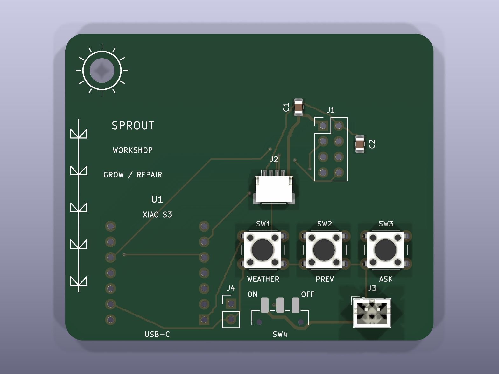

I wanted a small cyberdeck I could keep on a keychain and use while working on projects. This is SPROUT, a solarpunk themed board with a weather screen, buttons, and a headphone connection. The assistant runs on my laptop because I wanted to keep the device small.

The PCB is a 60 by 50 mm carrier for a Seeed XIAO ESP32-S3, an Adafruit 4440 OLED, and an Adafruit 6309 headphone DAC breakout. It has leaves on the silkscreen and a sun around the keyring hole. The DAC connects with a wire harness and needs its own mount.

Download solar-cyber.zip from this repository and unzip it. The complete project is inside, with the folders kept together. Open Sprout.kicad_pro in KiCad to work on the board. The fabrication folder has the Gerbers and drill files, and BOM.csv has the parts list. The software folder has the device code, laptop bridge, simulator, and setup instructions.

To run the laptop side, install Python 3.10 or newer and Ollama. Run ollama pull qwen3:1.7b, then open a terminal in the software folder and run python3 start_workshop.py. Weather defaults to Fort Lauderdale in Fahrenheit and mph. The workshop assistant uses the local model. Speech uses macOS say and afconvert.

For the device, copy Config.example.h to Config.h in software/firmware/Sprout and add your Wi-Fi details, laptop address, and bridge token. Run the laptop bridge with --lan so the keychain can connect on your local Wi-Fi. Keep Config.h and the generated token private. Open Sprout.ino in Arduino IDE with the XIAO ESP32S3 board selected, install the libraries listed in the software README, and rebuild before uploading. The included binaries use placeholder settings.

The simulator files are in software/simulator. Copy sketch.ino, diagram.json, and libraries.txt into a new ESP32-S3 project on Wokwi and start it. It tests the screen and buttons using labelled demo weather and answers. It does not simulate the battery, physical PCB copper, or headphone electronics.

The PCB passed the saved KiCad DRC and ERC checks. The firmware compiled, 19 core checks and 13 bridge tests passed, and the simulator was tested. Real weather, local model responses, and speech conversion were also tested on the laptop. I still need to assemble the physical board and check fit, charging, current draw, Wi-Fi, and headphone output before calling it finished.

The board render is below. The editable board and schematic and a copy of the firmware source are also visible directly in this repo. Use the ZIP for the complete folder layout and custom footprint library. bom.csv is the USB prototype budget estimate; it substitutes a SparkFun OLED, assumes some existing workshop supplies, and still needs exact small-part and delivery quotes. Shipping and tax are not included in its $30 parts target.

